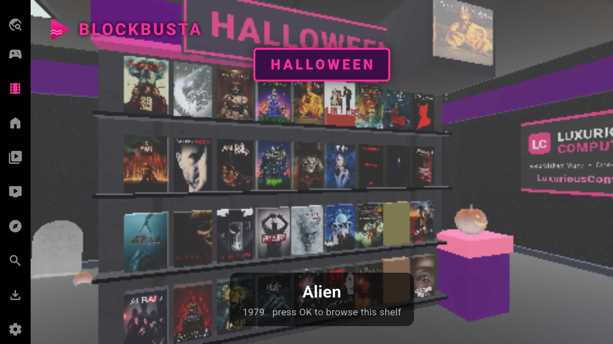

# Beam

A free, open-source media center for your Plex and Jellyfin libraries, with a walkable Halloween Blockbusta video store, TV remote navigation and optional streaming services.

**[Download Beam 2.10.1 beta](https://github.com/nodnarbrox/beam/releases/tag/v2.10.1-beam.1)** — available for Android TV / Onn, Windows, Linux and Mac.



*Halloween Blockbusta with library movie covers on its shelves. Actual screenshot from an earlier development build.*

## Downloads

| Platform | Download | Requirements and launch |
| --- | --- | --- |
| Android TV / Onn | [32-bit ARM APK](https://github.com/nodnarbrox/beam/releases/download/v2.10.1-beam.1/beam-2.10.1-armeabi-v7a.apk) | Android 7.1 / API 25 or newer, `armeabi-v7a`. Install the APK; this is the tested 32-bit Onn build. |
| Windows | [Windows x64 ZIP](https://github.com/nodnarbrox/beam/releases/download/v2.10.1-beam.1/beam-2.10.1-windows-x64.zip) | Extract the entire folder and run `Beam.exe`. Runtime DLLs are included. Unsigned beta executable. |
| Linux | [Linux x64 archive](https://github.com/nodnarbrox/beam/releases/download/v2.10.1-beam.1/beam-2.10.1-linux-x64.tar.gz) | Ubuntu 24.04 build. Extract and run `./plezy`; GTK, libmpv, libtorrent-rasterbar and their runtime dependencies must be installed. |
| Mac | [Apple silicon ZIP](https://github.com/nodnarbrox/beam/releases/download/v2.10.1-beam.1/beam-2.10.1-macos-arm64.zip) | macOS 26 or newer, Apple silicon. Extract and open `Beam.app`. Built and tested on the MacBook Pro; ad-hoc signed, without Apple notarization. |

[Release notes, source archives and SHA-256 checksums](https://github.com/nodnarbrox/beam/releases/tag/v2.10.1-beam.1) accompany the downloads. See [DESKTOP_BUILD.md](DESKTOP_BUILD.md) for desktop dependencies and build instructions.

## Getting started

1. Install or extract the package for your device.
2. Sign in to your own Plex or Jellyfin server to access your library.
3. Open **Store** for Halloween Blockbusta, or use **Search** to browse. Optional streaming configuration is under **Settings → Beam streaming**.

The separate **Beam Search** navigation tab has been removed. The Android package keeps the existing app ID and update certificate so compatible installs can update while retaining their account data.

## Halloween store and remote controls

The store includes scrolling video racks, pumpkins, haunted props and fixes for focus handoff, turning, Back navigation and repeated OK presses.

| Control | Action in the 3D store |
| --- | --- |
| Hold Up | Walk forward. |
| Left / Right | Turn. |
| OK / Select | Browse a nearby rack. |
| Back / Escape | Leave rack browsing or return focus to navigation. |

## When Plex won't play

Beam includes recovery for these Plex playback problems. It tries your own library first; after a failed library retry, it can search configured alternative sources for the same movie or episode.

| Problem | What Beam does |
| --- | --- |
| Plex returns HTTP 500, including a rejected original-quality stream | Retries once at 480p / 1.5 Mbps before trying an alternative source. This can help when a relay or server limit prevents the original stream from playing. |
| A library stream fails, its file is unavailable, or transcoding fails | Makes one library retry at the lower quality, then attempts the same title through Beam streaming if playback still fails. |
| A dead transcode keeps showing a loading spinner | Detects repeated failed HLS video segments and enters the library-retry / alternative-source recovery path instead of waiting indefinitely on those segments. |
| Android's ExoPlayer cannot play the stream | Switches to the bundled MPV player with the playback position carried into the replacement player. Device codec support still varies. |
| A normal Plex video fails with a missing `youtube-dl` / `yt-dlp` error | Disables MPV's unnecessary website-download hook for these video URLs. |
| Buffering consumes too much memory on a small Android TV device | Caps MPV's demuxer buffers according to the device heap to reduce memory pressure. This cannot prevent every out-of-memory failure. |
| Plex is unreachable while resolving a known title | Can continue to configured alternative sources using that title's metadata. It cannot discover an unknown library from an offline server. |
| A Plex Live TV stream fails | Retries with progressively reduced direct-stream support, allowing server transcoding. Live TV does not use movie/episode alternative-source recovery. |
| One alternative streaming path fails or is slow | When both are configured and available, races Real-Debrid and native torrent streaming; a failed path does not immediately abandon the other. |
| Recovery keeps reopening the same broken library stream | Bounds library retries and skips the already-failed library lookup when moving to alternatives. A failed Beam direct stream cannot recursively trigger the same fallback. |

Alternative-source selection checks movie and episode identity, including season and episode numbers, to reduce wrong-title playback. Back can cancel source preparation. If no suitable source succeeds, Beam reports the failure rather than claiming playback worked.

**Library recovery in the 2.10.2 development build:** Blockbusta reloads its shelves when libraries arrive after startup, a server connection recovers, or the active profile changes. Empty shelves offer an OK-to-retry action, and late results from the previous profile are discarded. This fix is installed on X1 and present in the source; the downloads above remain the published 2.10.1 beta.

Beam itself is free. Alternative streaming needs your own configured services and an available source; Real-Debrid requires its own paid account. Native torrent streaming requires the app's VPN/proxy privacy checks to pass. Beam cannot restart a stopped Plex server, repair its files, fix account permissions, or guarantee every codec or title will play. These are implemented recovery paths; complete Plex playback on the TV is still awaiting verification against a reachable, signed-in server.

## Beta testing and known limits

All **41 focused app tests** and **4 release-packaging tests** passed, and the Flutter analyzer reported no issues. Source and binary packages passed automated privacy checks; public download checksums were verified.

| Platform | Checks completed |
| --- | --- |
| Onn Android TV | Updated install, Halloween rendering, remote key-event navigation, installed native-library hash and an isolated piece-retention regression. |
| Windows | App startup, packaged DLL loading, torrent-file loading and decoding an owned H.264 test clip through the packaged media library. |
| Linux | Native-library loading, dependency resolution and a 20-second headless startup check in GitHub Actions. |
| MacBook Pro | Fresh app startup, native-library and torrent-file loading, bundled dependencies, Apple silicon architecture and signature verification. |

The Onn Halloween scene measured about **11 FPS** with reduced effects. Physical remote hardware has not been tested. The test Plex server was unreachable, so title pickup and Plex playback on the TV remain unverified. Complete desktop playback and control-overlay flows also remain unverified. See the release notes for the full test scope.

## Development

Use Flutter **3.44.8** and Dart 3.12.2; Windows uses **3.44.0** to match its pinned patched video-compositing engine. The store uses flutter_scene 0.16.0. Dependencies requiring forked Git revisions are vendored at their pinned revisions under packages/vendor.

```sh
flutter pub get
flutter analyze --no-pub
python -m unittest discover -s test/release -v
flutter test --no-pub --concurrency=1 test/navigation/navigation_tabs_test.dart test/screens/video_store_remote_test.dart test/services/direct_tv_service_test.dart test/screens/direct_tv_screen_test.dart test/widgets/side_navigation_rail_test.dart test/screens/main_screen_layout_test.dart
```

Android development also requires SDK 36, NDK 29.0.14206865 and CMake 3.31.6. See [NATIVE_BUILD.md](NATIVE_BUILD.md) for the exact native source and build record. Native libtorrent must be rebuilt from this repository's patched source; substituting an unpatched upstream binary changes its ABI and privacy behavior. Native binaries and signing keys are not committed to Git. Emulator cores and firmware are not included. See emulator_plugins/README.md for the optional core build path.

## Configuration

Plex/Jellyfin sign-in, streaming service credentials, optional proxies and TV tuner addresses belong to each user and are entered on their device. There is no default private TV server or Prowlarr key.

Optional Trakt, MyAnimeList, Simkl and YouTube account integrations require the maintainer's own registered application configuration. Error reporting is off by default and has no bundled reporting endpoint. Do not commit environment files, service credentials or signing keys.

## License and attribution

Beam is independently maintained and is not an official Plezy release. It is based on [Plezy](https://github.com/edde746/plezy) and distributed under the included [GPLv3 license](LICENSE). Dependencies retain their own licenses and notices.

This fork is based on the owner's modified checkout at upstream-base commit `3e3bafa`, with the separately developed Halloween store integrated. The public repository contains no prior private history. See [BEAM_CHANGES.md](BEAM_CHANGES.md) for the change scope.
